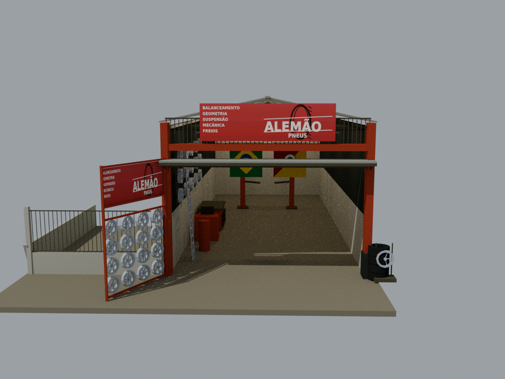
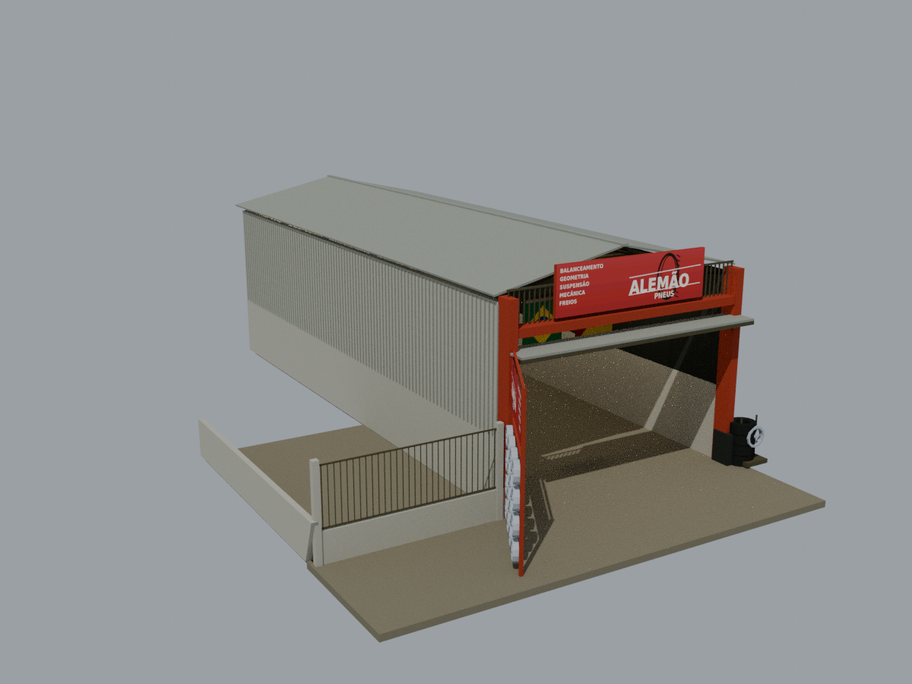
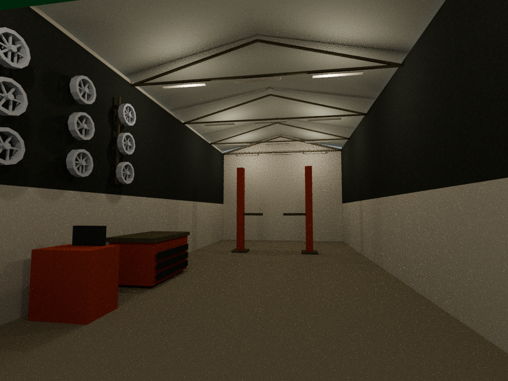

# Alemão Pneus — oficina MLO editável

Reconstrução da oficina das três fotos fornecidas. As duas placas foram redesenhadas **sem números de telefone**. Fachada vermelha, grade superior, portão expositor aberto com rodas, expositor direito/pneus, cobertura metálica, pátio lateral cercado e galpão com circulação de veículos. Não inclui pessoas, carros, prédios vizinhos ou postes/fiação da rua.





Veja também [como baixar pelo VS Code e abrir o Blender pelo terminal](ABRIR_NO_VSCODE.md).

## Abrir e editar

Para mexer em paredes, rodas, placas e demais peças como objetos independentes, abra **`blender/alemao_pneus_pecas_editaveis.blend`**. Essa cópia já abre com a coleção de peças ativa e a versão agrupada oculta. Para o fluxo GTA, abra `blender/alemao_pneus_master.blend` no Blender 4.3.2 com Sollumz. As imagens estão empacotadas. O arquivo pode ser inspecionado sem o addon, mas a edição/exportação dos dados GTA requer Sollumz.

- `EDITAVEIS_pecas_individuais`: cópia independente das paredes, estrutura, placas, rodas, pneus, equipamentos e cobertura, com nomes descritivos. Está oculta para evitar sobreposição com a versão de exportação. Para editar essas peças, ative a coleção no Outliner e oculte `ap_arquitetura`. As alterações nessa cópia **não atualizam automaticamente** as malhas de exportação.
- `ap_arquitetura`: entidades `ap_exterior` e `ap_oficina`, com modelos GTA High/Medium/Low e luzes reais. No modo de edição, use seleção de partes conectadas (`L`) para editar uma parede/peça da malha High. Se alterar a geometria exportada, regenere também LODs, colisão e bounds correspondentes.
- `ap_colisao`: composite `ap_mlo`, BVH e malha `ap_colisao_malha`, com materiais/IDs de sala. A colisão é separada da malha visual e deve ser atualizada quando as paredes forem alteradas.
- `ap_mlo_guias`: portal de entrada. Os dados de salas e entidades estão registrados no YTYP do Sollumz, não apenas nomeados como MLO.
- `texturas/`: PNGs editáveis e DDS de exportação. A placa está em `ap_placa_sem_telefone.png`. Para substituir arte sem sobrescrever o PNG, use `scripts/atualizar_texturas.py`, depois recompile a YTD. Recarregue a imagem correspondente no Blender e empacote-a novamente ao atualizar o master. A geração procedural em `texturas.py` recria os PNGs; não a execute sobre arte alterada sem backup.

Os scripts usam caminhos relativos ao próprio projeto e `VANO_TOOLS` para ferramentas. As peças são produzidas em `scripts/construir.py`, com posições e dimensões explícitas em metros. A reconstrução completa substitui alterações manuais no master: faça uma cópia antes.

## Arquivos e instalação no FiveM

`stream/` contém **2 YDR + 1 YBN + 1 YTD + 1 YTYP** binários GTA V Gen8. `exemplos/` contém um YMAP binário CMloInstanceDef na origem. `xml/` contém as fontes correspondentes; `relatorios/roundtrip/` contém a releitura dos arquivos compilados.

1. Abra no CodeWalker o YTYP e o YMAP de exemplo, disponibilizando os arquivos de stream.
2. Posicione a instância **`ap_mlo`** no endereço escolhido do seu mapa, recalcule os extents e salve o YMAP dentro de `stream/`. Não coloque `ap_exterior`/`ap_oficina` como objetos separados.
3. Copie a pasta `alemao_pneus` para `resources/[maps]/` e adicione `ensure alemao_pneus` ao `server.cfg`.
4. Teste passagem de carros, colisões, iluminação, portais, streaming e desempenho no cliente FiveM.

**O exemplo na origem não é instalado automaticamente. Sem um YMAP posicionado em stream, o recurso registra os arquivos, mas não coloca a oficina no mapa.** As coordenadas reais da loja não equivalem a coordenadas GTA; nenhum local foi inventado no servidor.

## Fidelidade e medidas

As fotos permitem reconstruir a aparência da entrada e parte dos equipamentos, mas não fornecem levantamento métrico, planta ou vista dos fundos. A largura do galpão foi estimada em 7,2 m e a profundidade em 18 m. O envelope com pátio, expositores e calçada mede aproximadamente 13,32 × 21,60 m. O telhado chega a 6,43 m sobre o piso; o piso tem base até −0,18 m.

O salão permanece aberto, com um único ambiente interior. Não foram inventados banheiro, escritório ou divisórias invisíveis. Rodas, escada, bancada, compressor/balanceadora e elevador são aproximações das silhuetas visíveis; o detalhamento do fundo e a profundidade são estimados. A bandeira estadual é uma representação simplificada. A placa foi redesenhada e não constitui reprodução exata do logotipo. A fidelidade não pode ser garantida para áreas ocultas.

## Otimização e validação

- 10.824 triângulos High; versões Medium e Low simplificadas para distância. Consulte `relatorios/geometria.json` para contagens finais por entidade.
- 432 triângulos de colisão BVH. Expositores usam proxies simples; os aros não têm colisão por raio individual.
- 12 texturas compartilhadas, com mipmaps completos; maior imagem 1024 × 256, mapas repetíveis de 128–512 pixels. YTD compilada de cerca de 341 KiB.
- MLO com limbo exterior + oficina, 1 portal e 2 entidades. 8 luzes GTA com horários válidos, interiores e com sombras.
- Compilação e releitura dos 6 binários; validação de MLO, UVs/layout, índices, referências de textura, mipmaps, LODs e colisão.
- 39 verificações físicas por raycast no master e as mesmas 39 no YBN compilado/reimportado: entrada, circulação, paredes, fundos, expositor e continuidade de piso.

Não houve teste dentro do GTA/FiveM nem medição de FPS. Os checks de arquivo não comprovam o comportamento do motor. A implantação final exige essa conferência após posicionar.

## Reproduzir

Ferramentas externas: Blender 4.3.2, Sollumz `2cae10b4f14eb0ed2aea92bfd7d8a83fb4c8f769`, szio `1.4.0.dev2`, CodeWalker `485d56bec00262ed7fa472261cce7bbc6202b96e` e .NET SDK 8.0.426. O upstream não é redistribuído nesta pasta. As ferramentas já estão em `/workspace/tools` neste ambiente.

```bash
cd /workspace/sedeppl-ajustada/alemao_pneus
# Atenção: recria os PNGs, o master e as exportações; preserve edições manuais.
AP_RENDER=1 bash scripts/reconstruir.sh
```

Para somente conferir a entrega:

```bash
/workspace/tools/venv/bin/python scripts/validar_gta.py
BLENDER_USER_CONFIG=/workspace/tools/blender-config blender -b --python-exit-code 1 --python scripts/validar_blender.py
BLENDER_USER_CONFIG=/workspace/tools/blender-config blender -b --python-exit-code 1 --python scripts/validar_blender.py -- --colisao-compilada
```

As fontes do compilador estão em `scripts/compilador/`. Sua compilação usa `-p:CodeWalkerRoot=/caminho/CodeWalker` fora do ambiente preparado. O projeto Boteco Colorado e os assets anteriores não foram modificados.
