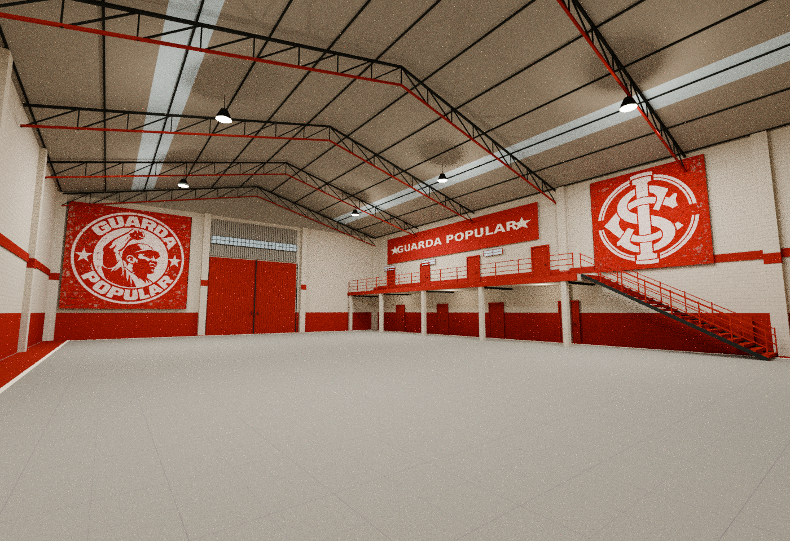
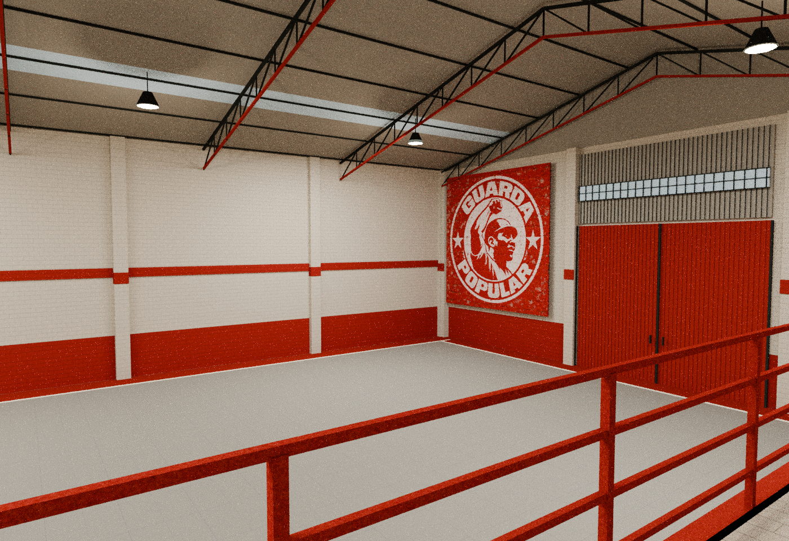
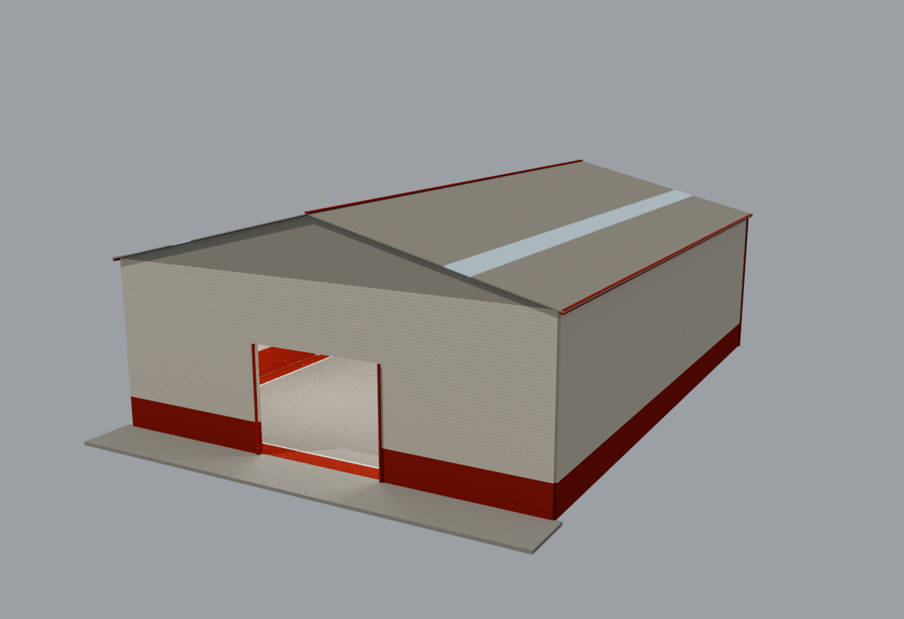
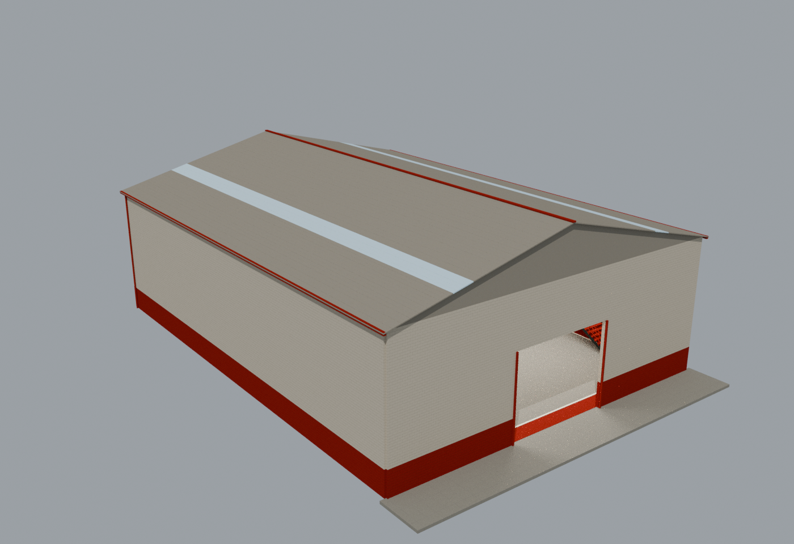

# Galpão anexo — Guarda Popular

Exterior e MLO independente, reconstruídos a partir da imagem fornecida: salão amplo, piso de concreto com bordas vermelhas/brancas, pilares pintados, cobertura metálica em duas águas, treliças aparentes, faixas de claraboia, luminárias suspensas, portão vermelho de fundo, murais, passarela elevada e escada.






## O que é fiel e o que foi estimado

A imagem é uma referência visual, sem escala, planta ou vistas externas. A composição, cores e elementos visíveis orientam o modelo; medidas e proporções não são um levantamento do imóvel. O galpão foi estimado em **24 × 32 m**, beiral de 9 m, cumeeira próxima de 12 m e passarela a 3,50 m. Os murais foram reconstruídos visualmente por geração de imagem a partir da referência; não são a arte original nem uma cópia exata do brasão/monograma. As fontes PNG permitem substituí-los.

O exterior e a parede oposta à câmera são propostas compatíveis com o galpão, pois não aparecem na referência. Um acesso aberto foi colocado nessa face para permitir entrada funcional. O grande portão vermelho da parede fotografada permanece fechado. As portas laterais são painéis fechados decorativos: não foram inventados escritórios, banheiros ou salas atrás delas. O mezanino permanece uma passarela aberta no mesmo salão. Não foram adicionados móveis sem apoio na referência.

## Arquivos editáveis

- **`blender/galpao_anexo_pecas_editaveis.blend`** abre **776 peças independentes**: paredes, estrutura, telhas, pilares, escada, guarda-corpos, murais e portas como objetos separados. Cada peça tem `grupo_exportacao`: exterior, salao ou mezanino.
- **`blender/galpao_anexo_master.blend`** contém a versão GTA com entidades, LODs, luzes, YTYP/MLO e colisão BVH. A coleção `EDITAVEIS_pecas_individuais` está preservada e oculta para não sobrepor o export.
- **`texturas/*.png`** são as fontes editáveis; DDS e YTD têm mipmaps completos. `ga_murais_fonte.png` é o atlas fonte dos dois murais; `ga_murais.png` é sua versão otimizada para o jogo. A faixa escrita é `ga_faixa_guarda_popular.png`.
- **`xml/`** contém fontes CodeWalker; **`relatorios/roundtrip/`** contém os XMLs relidos dos binários compilados.
- **`scripts/`** contém construção, texturas, compilador, sincronização das peças e verificações.

O Blender 4.3.2 foi usado com Sollumz. As texturas estão empacotadas nos `.blend`. Ative Sollumz antes de carregar o arquivo para ler/editar propriedades GTA e visualizar corretamente os materiais. Instale o addon oficial em https://github.com/Sollumz/Sollumz seguindo as instruções de instalação do projeto.

## Abrir pelo terminal do VS Code

Na raiz do repositório, no **PowerShell do computador local**, se arquivos `.blend` já abrem pelo Blender:

```powershell
Invoke-Item ".\galpao_anexo\blender\galpao_anexo_pecas_editaveis.blend"
```

Para localizar uma instalação convencional do Blender e executá-la:

```powershell
$blenderExe = Get-ChildItem "C:\Program Files\Blender Foundation" -Filter blender.exe -Recurse -ErrorAction SilentlyContinue | Select-Object -First 1 -ExpandProperty FullName
if ($blenderExe) { & $blenderExe ".\galpao_anexo\blender\galpao_anexo_pecas_editaveis.blend" }
```

Se a busca não encontrar nada, localize a instalação pela Steam/Microsoft Store ou use o executável instalado em outro caminho. Não presuma a existência da pasta `Blender 4.3`.

Linux/macOS com Blender no PATH:

```bash
blender ./galpao_anexo/blender/galpao_anexo_pecas_editaveis.blend
```

Um terminal remoto sem interface gráfica não abre a janela no seu computador. Baixe o ZIP ou copie a pasta para a máquina local para editar pela interface.

## Editar e atualizar os arquivos GTA

Faça backup antes de substituir o master ou reconstruir. A geração completa em `scripts/construir.py` é procedural e substitui edições manuais.

1. Edite os objetos em `galpao_anexo_pecas_editaveis.blend`, mantenha a propriedade `grupo_exportacao` e salve.
2. Atualize explicitamente a colisão se mover paredes, pisos ou escada. Ela é independente, na coleção `ga_colisao`, inicialmente oculta nessa cópia. Salas e portal também precisam acompanhar mudanças no envelope/acesso.
3. Rode `scripts/sincronizar_pecas.py` pelo Blender para transferir as peças salvas para os modelos High do master. O script não cria colisões automaticamente nem substitui revisões de portal/salas. O master será substituído pela versão sincronizada.
4. Rode `finalizar.py` para recalcular os LODs e limites, `preparar_meta.py` e o compilador C#, e repita as validações.

No ambiente preparado:

```bash
cd /workspace/sedeppl-ajustada/galpao_anexo
export VANO_TOOLS=/workspace/tools BLENDER_USER_CONFIG=/workspace/tools/blender-config
blender -b --python-exit-code 1 --python scripts/sincronizar_pecas.py
GA_SKIP_RENDERS=1 blender -b --python-exit-code 1 --python scripts/finalizar.py
/workspace/tools/venv/bin/python scripts/preparar_meta.py
/workspace/tools/dotnet/dotnet scripts/compilador/bin/Release/net8.0/vano_compilador.dll . /workspace/tools
/workspace/tools/venv/bin/python scripts/validar_gta.py
blender -b --python-exit-code 1 --python scripts/validar_blender.py
blender -b --python-exit-code 1 --python scripts/validar_blender.py -- --colisao-compilada
```

Para mudar somente PNGs, rode `scripts/atualizar_texturas.py` para refazer DDS/YTD XML sem recriar a arte, depois recompile e recarregue/empacote as imagens no Blender. O arquivo `ga_murais_fonte.png` não entra diretamente na YTD: altere `ga_murais.png` para atualizar apenas a textura de jogo. `texturas.py` recria as texturas procedurais e otimiza novamente o atlas fonte; preserve sua arte antes de executá-lo.

## Instalação FiveM

`stream/` contém **3 YDR, 1 YBN, 1 YTD e 1 YTYP** binários GTA V Gen8. `exemplos/ga_implantacao_origem.ymap` é um exemplo binário com **CMloInstanceDef `ga_mlo`** na origem.

1. Abra o YTYP e o YMAP no CodeWalker com todos os arquivos de stream disponíveis.
2. Posicione a instância `ga_mlo`, recalcule extents e salve o YMAP dentro de `stream/`. Não coloque os três modelos visuais separadamente.
3. Copie `galpao_anexo` para `resources/[maps]/` e adicione `ensure galpao_anexo` ao `server.cfg`.
4. Teste acesso, escada, passarela, portais, colisão, iluminação e desempenho dentro do FiveM.

**O YMAP de exemplo fica fora de stream para evitar colocar o prédio em uma posição arbitrária. Sem posicionamento, o recurso registra os assets mas não aparece automaticamente.** Não foram alterados o Boteco Colorado, o Alemão Pneus ou o projeto antigo da sede.

## Otimização e verificações

- 8.854 triângulos High; 4.426 Medium; 2.212 Low, distribuídos entre exterior, salão e mezanino. Contagens por entidade em `relatorios/geometria.json`.
- Uma YTD compartilhada de cerca de 966 KiB, texturas pequenas com mipmaps, sem imagens acima de 1024 px na versão de jogo. O atlas fonte pode ter resolução maior e não é carregado pelo jogo.
- Colisão BVH simplificada com 784 triângulos. Degraus, piso elevado e guarda-corpos têm colisão; treliças/luminárias não exigem colisão visual detalhada.
- MLO real: limbo + salão, 1 portal de entrada e 3 entidades. O mezanino pertence ao mesmo ambiente aberto, sem uma divisão de culling artificial.
- 9 luzes GTA com horários válidos e sombras. As imagens de apresentação usam também luzes de área temporárias; elas não são gravadas/exportadas como luzes GTA adicionais.
- Releitura dos 7 binários pelo CodeWalker.Core e checks de conectividade, referências, UVs/layout, índices, LODs e mipmaps.
- 121 verificações físicas no master e repetidas na colisão compilada/reimportada: acesso, limites, pisos, 21 degraus, altura livre, passarela, guarda-corpos e cobertura.

Não houve execução no GTA/FiveM nem medição de FPS. Validação dos arquivos e raycasts não substitui o teste do motor após posicionar o recurso. Os relatórios registram o alcance dos checks.

## Reproduzir a geração original

Blender 4.3.2, Sollumz `2cae10b4f14eb0ed2aea92bfd7d8a83fb4c8f769`, szio `1.4.0.dev2`, CodeWalker `485d56bec00262ed7fa472261cce7bbc6202b96e`, .NET SDK 8.0.426 e dependências Python em `scripts/requirements.txt`. O código upstream não está incluído; no ambiente preparado, as ferramentas ficam em `/workspace/tools`.

```bash
cd /workspace/sedeppl-ajustada/galpao_anexo
# Recria texturas, master e exportações; preserve edições manuais antes.
GA_RENDER=1 bash scripts/reconstruir.sh
```

A consulta/renderização não requer servidor FiveM. A compilação usa a biblioteca CodeWalker.Core compatível com Linux; a interface Windows do CodeWalker e o cliente GTA não são executados aqui.
