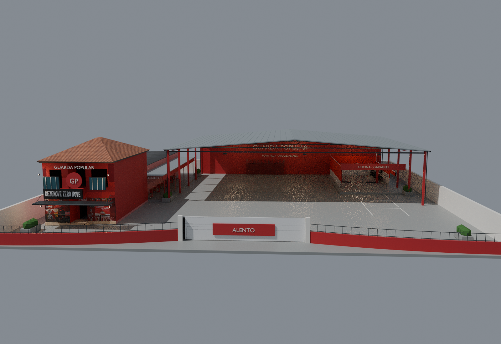
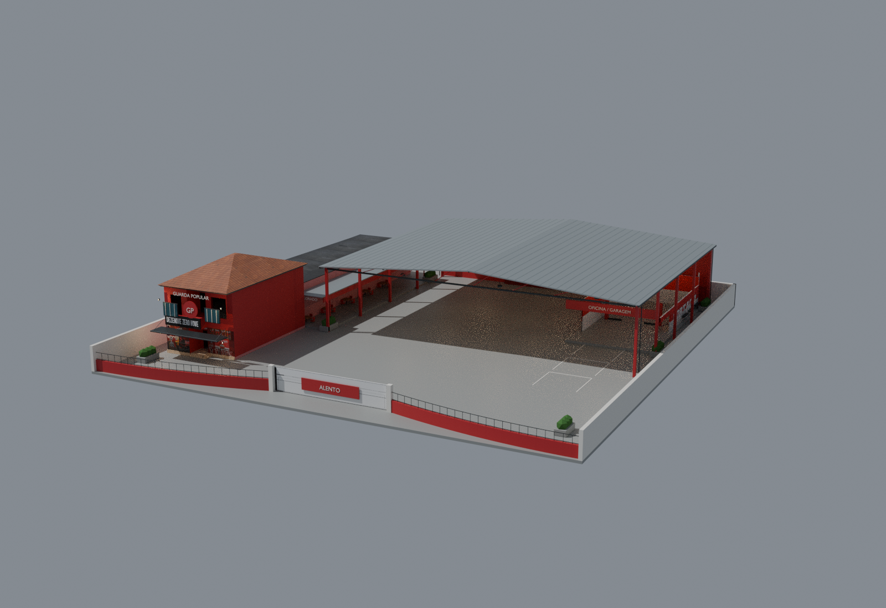
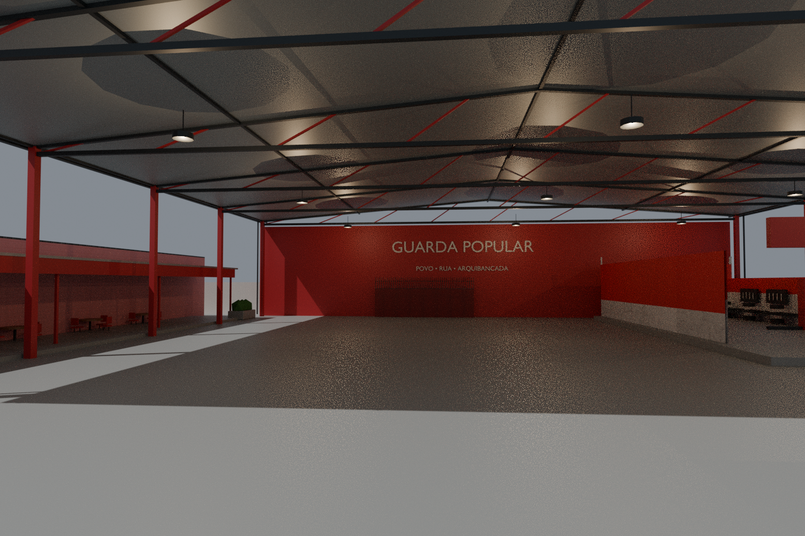
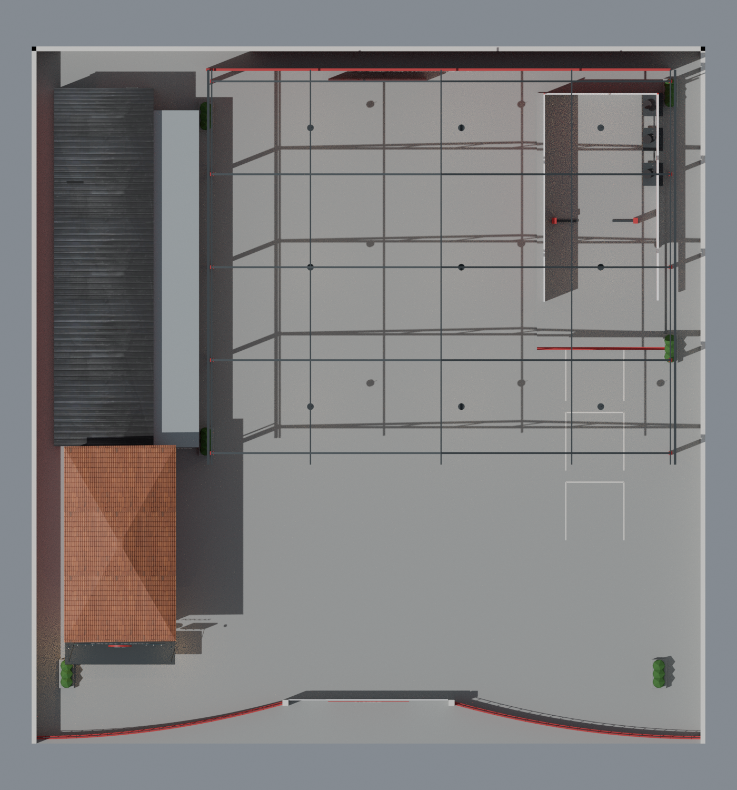

# vano_ — reconstrução da sede Guarda Popular

Versão arquitetônica editável para avaliação, desenvolvida a partir dos assets deste repositório e da referência visual fornecida pelo solicitante. **Ainda não é um recurso FiveM jogável concluído.**

## Boteco Colorado independente

A versão separada do boteco, baseada na nova referência, está em [vano_boteco_colorado](../vano_boteco_colorado/README.md), com master Blender, MLO de salão/banheiro/depósito, colisão BVH, texturas e arquivos GTA compilados. Essa pasta não substitui o estudo da sede abaixo.

## Abrir o projeto

O master ultrapassa o limite de 100 MiB por arquivo do GitHub; por isso está versionado com compressão sem perdas. Não é necessário Git LFS.

- **`vano_sede_master.blend.gz`**: master completo. Descompacte com 7-Zip ou `gzip -dk vano_sede_master.blend.gz` e abra `vano_sede_master.blend` no Blender.
- **`vano_projeto_editavel.zip`**: alternativa com o mesmo master descompactado, quatro previews, relatórios e scripts.
- **`vano_conversoes_xml_dds.zip`**: XMLs dos 76 recursos, DDS por asset e código local do conversor em lote.
- **`vano_biblioteca_originais.blend.gz`**: biblioteca intermediária importada pelo Sollumz. O master já contém uma cena de biblioteca, com correções posteriores de variantes de textura.

Os arquivos `.blend1` de salvamento automático e os caches/binários de compilação não foram versionados. Os estudos intermediários, imagens de inspeção, relatórios JSON, scripts e logs de execução foram mantidos nesta pasta. Os assets originais em `../stream/` permanecem inalterados.

## Previews reais do Blender

### Frente

### Perspectiva

### Pátio

### Planta

[Esquema cotado](vano_implantacao_cotada.svg) · [Relatório técnico completo](vano_relatorio.md)

## Medidas extraídas da geometria

| Item | Resultado | Margem para o limite |
|---|---:|---:|
| Implantação | 58 × 60 m / 3.480 m² | 20 m² |
| Construção mais alta | 10,78 m | 4,22 m |
| Muros | 3,00 m | 5,60 m |

Os valores completos estão em `vano_medidas.json` e `vano_validacao.json`. A área inclui toda a implantação. As dimensões dos conjuntos são envelopes externos, não áreas internas úteis. O estudo avaliado contém cerca de 35,8 mil triângulos, incluindo textos e modificadores.

## O que foi feito

- Inventário de todos os arquivos e hashes SHA-256; descompressão bem-sucedida dos 76 contêineres RSC7.
- Conversão em lote no Linux com a biblioteca oficial CodeWalker.Core; 76 sucessos, zero falhas. Importação dos 47 YDR/YFT/YBN no Sollumz/Blender.
- Reaproveitamento das malhas do bar, Alento, galpão, portão e muro. Desenvolvimento da cobertura industrial, treliças, calhas, caixilhos, marquises, grades curvas, mobiliário e elementos de oficina.
- Master em metros com cenas `vano_PROJETO` e `vano_BIBLIOTECA_ORIGINAIS`, prefixo `vano_`, texturas disponíveis empacotadas e câmeras de avaliação.
- Preservação das texturas homônimas por asset e verificação dos arquivos originais contra os hashes do inventário.
- Animação de estudo do portão nos frames 1 e 100; extremos dentro do perímetro.

## Limitações e reprodução

Ainda faltam refinamento visual, revisão de aberturas/circulação, shaders e UVs finais para GTA, colisões da nova implantação, mipmaps, LODs, exportação do recurso e testes no CodeWalker/FiveM. A animação Blender não é um controlador de portão FiveM. Não há alegação de FPS validado, aprovação da staff ou fidelidade integral à fotografia.

Os scripts e logs foram preservados como executados no ambiente de desenvolvimento. Usam caminhos absolutos `/workspace/projeto-guarda-popular`, `/workspace/sedeppl-ajustada` e `/workspace/tools`; ao clonar em outra máquina, ajuste esses caminhos. As ferramentas upstream não são incluídas: consulte os commits e instruções no [relatório](vano_relatorio.md) e no [conversor](ferramentas/conversor/README.md).

O manifesto `vano_manifesto_entrega.json` descreve os arquivos originais da entrega, inclusive o master descompactado dentro do ZIP. Alguns logs e relatórios de etapas iniciais descrevem estados intermediários; a referência final é o master, `vano_relatorio.md`, `vano_medidas.json` e `vano_validacao.json`.

Não foi localizada licença explícita dos assets no repositório. A adaptação local foi autorizada pelo solicitante; não há afirmação de titularidade ou permissão para redistribuição pública de conteúdo de terceiros.
