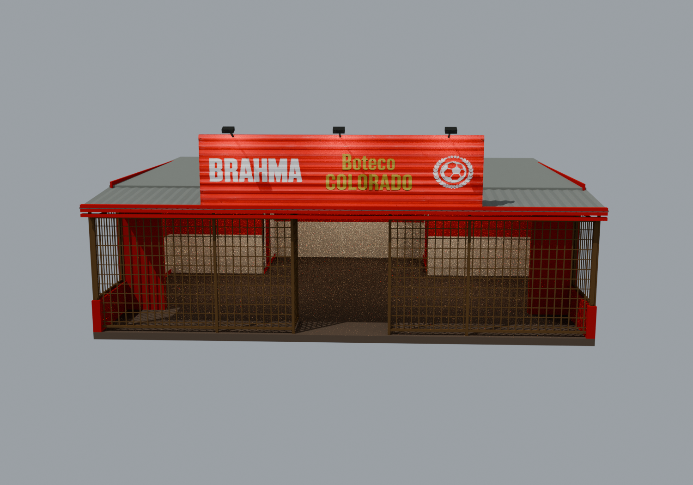
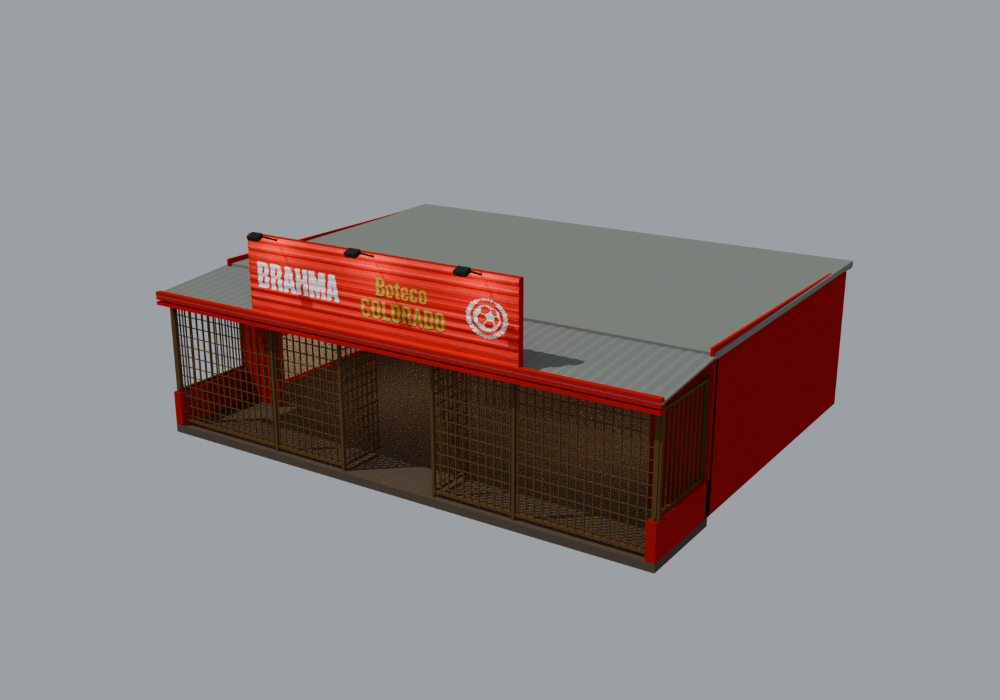
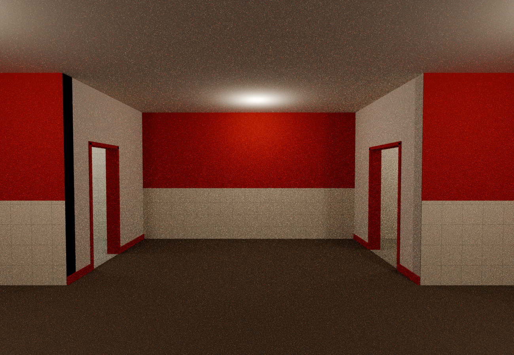
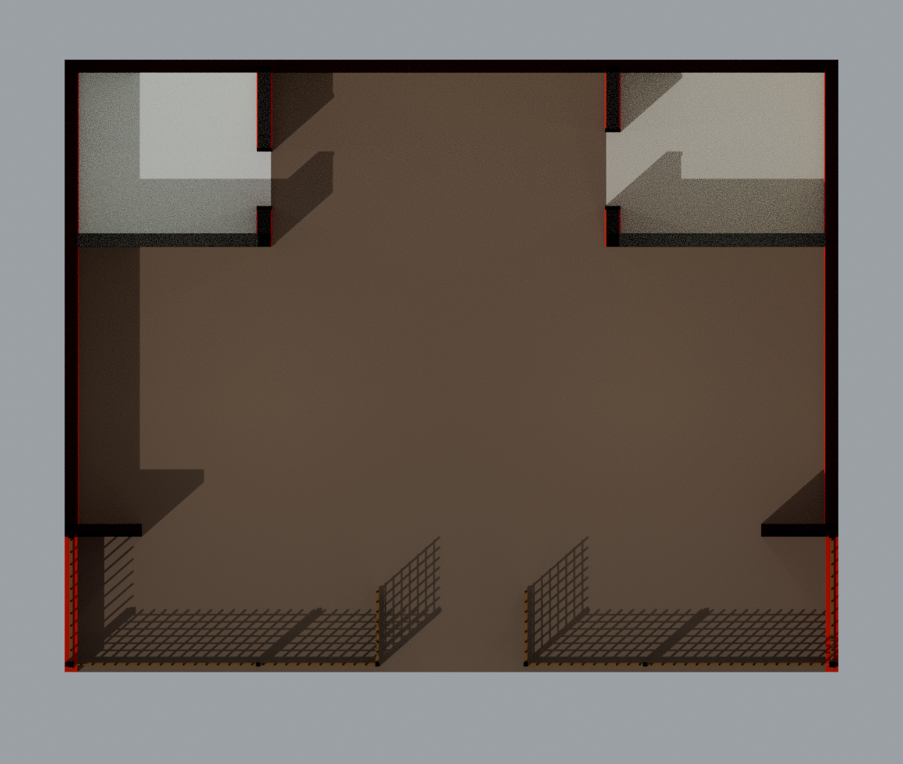

# vano_ — Boteco Colorado independente / MLO

Somente o boteco térreo, sem o prédio acima. Salão, área de apoio/circulação, banheiro e depósito vazios. O portão central das grades é fixo na posição aberta; não existe script que possa fechá-lo.

## Entrega

- [Master Blender editável](blender/vano_boteco_colorado_master.blend), comprimido internamente sem perda, com geometria, shaders GTA, imagens empacotadas e dados MLO registrados no Sollumz.
- `stream/`: **5 YDR + 1 YBN + 1 YTD + 1 YTYP**, todos binários RSC7 compilados e relidos pelo CodeWalker.Core.
- `xml/`: fontes CodeWalker XML correspondentes, incluindo a YTD e seus DDS.
- `texturas/`: PNGs de autoria/reconstrução e DDS DXT5 com cadeias completas de mipmaps.
- `exemplos/vano_bc_implantacao_origem.ymap`: exemplo binário **CMloInstanceDef**, na origem, separado do stream para evitar instalação em posição indesejada.
- `scripts/`: construção, texturização, compilador, posicionamento e verificações.
- `relatorios/`: medidas, inventário e resultados das verificações, inclusive XMLs relidos dos binários finais.

## Previews renderizados do modelo









[Planta cotada dos setores](previews/vano_bc_planta_cotada.svg). O corte horizontal foi feito somente na apresentação; o master e os assets GTA conservam teto e cobertura completos.

## Dimensões medidas

Corpo nominal: **12 × 9,5 m**. O envelope geométrico completo, incluindo beirais e braços dos refletores, mede **12,20 × 10,43 m**, com área envolvente de **127,25 m²**. A cota mais alta é **4,97 m acima do piso**; pé-direito interno de **3,10 m**. A base desce 0,18 m abaixo da cota do piso; por isso, a dimensão Z integral é diferente da altura sobre o piso.

| Setor | Dimensões internas definidas pelos volumes MLO | Área |
|---|---|---:|
| salao | 11,60 × 4,30 m | 49,88 m² |
| circulacao | 5,20 × 2,70 m | 14,04 m² |
| banheiro | 2,80 × 2,50 m | 7,00 m² |
| deposito | 3,20 × 2,50 m | 8,00 m² |

Varanda frontal de aproximadamente 12 × 2,2 m. Vão central das grades de aproximadamente 2,24 m livres entre faces das folhas abertas. Portas internas: vãos de alvenaria de 0,90 m para banheiro e 1,20 m para depósito; os batentes reduzem a largura visual em cerca de 6 cm. Sem folhas de portas, louças sanitárias, balcão, mesas, cadeiras ou decoração: esses itens podem ser acrescentados posteriormente com assets do jogo. Os refletores e a iluminação são elementos arquitetônicos.

## MLO efetivamente configurado

O YTYP contém um **CMloArchetypeDef** vinculado a `vano_bc_mlo.ybn`, do tipo ASSETLESS, além dos cinco arquétipos dos drawables. São **5 rooms**: `limbo` (exterior), `salao`, `circulacao`, `banheiro` e `deposito`, com **4 portais** bidirecionais e **5 entidades** atribuídas às respectivas salas.

A malha de colisão usa BVH com Room IDs de 0 a 4. Os pisos das soleiras são contínuos; as portas e o acesso central não estão bloqueados. As grades usam proxies de colisão simplificados para pedestres e flags de transparência/atravessamento de projéteis; não há colisão barra a barra. Pequenos suportes e refletores não têm colisão individual.

As oito luzes exportadas têm horários válidos para as 24 horas, alcance limitado e flag de sombra; as internas estão marcadas como interiores, e as da placa, como exteriores. Não foram criados móveis. Não há objetos globais de GTA base necessários para o modelo aparecer.

O conjunto tem **4.482 triângulos visuais** e **420 triângulos de colisão**. Há somente geometria High, com distância de arquétipo de 180 m; não são fornecidos modelos Medium/Low distintos. Existem **11 texturas**, todas com dimensões potência de dois e mipmaps. O binário YTD ocupa cerca de 1.30 MiB. Esses números não são medições de FPS ou VRAM real no jogo.

## Fidelidade à referência

Foram reproduzidos os elementos visíveis: placa vermelha corrugada com BRAHMA à esquerda, Boteco COLORADO ao centro e escudo à direita; três refletores projetados; testeira vermelha, grades metálicas de aspecto oxidado, varanda baixa, paredes vermelhas, faixa de azulejo claro e piso cerâmico castanho. O prédio branco e o carro da fotografia não fazem parte do boteco.

**A placa é uma reconstrução visual gerada a partir da foto, não extração pixel a pixel da arte original. O desenho do escudo, as letras e o desgaste não têm equivalência exata garantida.** As demais texturas foram produzidas proceduralmente a partir das cores e acabamentos visíveis, não escaneadas da fotografia. Para reprodução literal da identidade gráfica, substitua `texturas/vano_bc_placa_reconstrucao_original.png` pela arte original autorizada e regenere a YTD. O interior e os fundos são uma proposta funcional, pois a fotografia não mostra esses espaços; banheiro e depósito foram incluídos por solicitação do usuário.

## Instalar e posicionar

1. Copiar esta pasta para `resources/[maps]/vano_boteco_colorado` do servidor.
2. No CodeWalker, carregar `stream/vano_bc_arquetipos.ytyp` e o YMAP de `exemplos/`, mantendo os cinco YDR, a YTD e o YBN disponíveis no mesmo projeto/pasta de trabalho. Selecionar a instância **`vano_bc_mlo`**, não os componentes internos separadamente.
3. Mover/rotacionar essa instância para o local desejado e recalcular os extents do YMAP no CodeWalker. Salvar o YMAP posicionado dentro de `stream/`.
4. Adicionar `ensure vano_boteco_colorado` ao `server.cfg` e reiniciar/recarregar o recurso.
5. Testar entrada, transições entre salas, ocultação pelos portais, iluminação diurna/noturna, colisões e desempenho no FiveM antes de usar em produção.

**Sem um YMAP posicionado em `stream/`, o recurso registra os arquétipos e arquivos, mas não coloca o boteco em nenhum endereço do mapa.** O exemplo na origem não deve ser instalado sem reposicionamento. Como a localização ainda não foi escolhida, não foi sobreposta nenhuma região do mapa base.

## Verificações executadas e limites

- Compilação e releitura de **9 binários**: os oito arquivos de stream e o YMAP de exemplo. Todos passaram, incluindo as referências de texturas e os dados MLO.
- Inspeção de conectividade dos portais, winding, planicidade, índices de sala, entidades anexadas e contagem de portais por sala.
- 25 checagens físicas por raycast na colisão Blender: acesso, portas, continuidade de pisos e paredes que devem bloquear.
- Master reaberto; texturas disponíveis e empacotadas; IDs de sala da colisão conferidos.
- Sem execução no GTA V, no visualizador DirectX do CodeWalker ou no cliente FiveM neste ambiente Linux. A validação de arquivo não prova comportamento do motor, sombras, streaming ou desempenho no jogo. A entrega exige essa validação após o posicionamento.

## Reproduzir a geração

Blender 4.3.2; Sollumz no commit `2cae10b4f14eb0ed2aea92bfd7d8a83fb4c8f769`, com `szio==1.4.0.dev2`; CodeWalker.Core no commit `485d56bec00262ed7fa472261cce7bbc6202b96e`; .NET SDK 8.0.426; Pillow e NumPy para os mapas de textura. O código upstream das ferramentas não está incluído.

O caminho da pasta do projeto é calculado pelos scripts a partir de `__file__`. As ferramentas são procuradas em `/workspace/tools`; em outra máquina, definir `VANO_TOOLS` para a pasta que contém `Sollumz/` e `pydeps/`. Para a compilação C#, definir `-p:CodeWalkerRoot=/caminho/CodeWalker` se necessário.

Sequência:

```bash
python3 scripts/texturas.py
BLENDER_USER_CONFIG=/workspace/tools/blender-config blender -b -t 6 --python scripts/construir_boteco.py
python3 scripts/preparar_meta.py
DOTNET_CLI_HOME=/workspace/tools/dotnet-home NUGET_PACKAGES=/workspace/tools/nuget /workspace/tools/dotnet/dotnet build scripts/compilador -c Release
/workspace/tools/dotnet/dotnet scripts/compilador/bin/Release/net8.0/vano_compilador.dll . /workspace/tools
BLENDER_USER_CONFIG=/workspace/tools/blender-config blender -b -t 6 --python scripts/finalizar_master.py
BLENDER_USER_CONFIG=/workspace/tools/blender-config blender -b --python scripts/validar_blender.py
python3 scripts/validar_gta.py
python3 scripts/documentar.py
```

A etapa `preparar_meta.py` calcula o envelope do CMloArchetypeDef e normaliza o limbo com os vértices medidos; o exportador Sollumz consultado escreve bounds MLO zerados por padrão. Não a omitir. O arquivo da placa reconstruída é mantido na pasta para que a geração não dependa do serviço de imagens. O relatório de build registra um aviso NU1900 por indisponibilidade da consulta de auditoria NuGet no ambiente; a compilação dos assets terminou sem falhas, sem desativar validação de certificados ou assinaturas.
